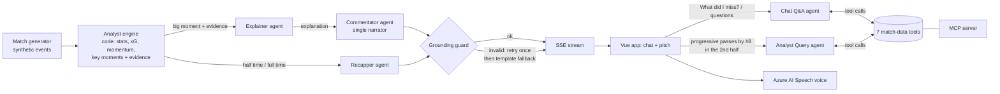

# Back to the Game

**A live, multi-agent match narrator that explains the game and talks to every fan in their own way.**
Built for the Microsoft + Premier League *Inside the Game* Developer Hackathon (2026), category **Best Multi-Agent System**.

**Live demo:** https://backtothegame.agreeablemeadow-1527bc53.westus3.azurecontainerapps.io
(open it and press *Kick off*; every visit plays a different match)

A pitch on the left, a live narration chat on the right. A crew of AI agents watches the match as it happens, finds the big moments, explains them with evidence and speaks them aloud. Every viewer gets their own version of the same match: a **fan** who follows a club and a favourite player, an **analyst** who wants layers and numbers, or a **blind or low-vision viewer** who listens to a descriptive broadcast. English and Spanish.

## The agent crew



| Agent | Job | Output |
|---|---|---|
| **Analyst engine** (code, not an LLM) | Keeps live stats and finds key moments: goals with context, big chances, great saves, momentum swings, red cards... each one with its **evidence** | Moments with numbers |
| **Explainer** | Turns the evidence of a big moment into a short "why it matters" | Structured explanation |
| **Commentator** | The single narrator. Writes one line per language, in the voice of the fan's club, with an emotion tag that drives the speech prosody | Commentary lines |
| **Recapper** | Half-time and full-time recaps, and "What did I miss?" catch-ups | Headline and text |
| **Chat Q&A** | Answers a viewer's question about the match using the tools below | Answer with sources |
| **Analyst Query** | Turns "progressive passes by #8 in the second half" into a filter drawn on the pitch | Overlay spec |

**How they work together**

- **Handoffs with structured outputs.** Each agent returns a Pydantic model through the Foundry Responses API (`responses.parse`), so the next stage never parses free text.
- **Shared tools.** Seven match-data tools (`get_match_state`, `get_team_stats`, `find_player`, `get_player_stats`, `find_events`, `get_key_moments`, `compare_players`) are one registry used by the agents in a tool-calling loop **and** exposed as an **MCP server** (`matchvoice mcp`), so any MCP client can query the live match.
- **Grounding guard.** Every number and proper name in an AI line must appear in the Analyst's evidence. A line that fails is retried once with feedback, and then replaced by a template line. The AI never invents a stat.
- **Graceful degradation.** Template narration arrives instantly for every event, so the chat and the voice never wait. After three consecutive agent failures the crew goes to degraded mode and the stream keeps running on templates.
- **Visible crew.** The *AI Crew* panel shows, live, which agent handled which moment, its status and latency.
- **Cost control.** Only moments with importance of 0.7 or more reach the AI (about six or seven per match), two calls at a time per stream, and `MAX_AI_STREAMS` caps concurrent AI streams. A full AI match costs roughly five cents (model plus speech; an estimate, check your own pricing).

**Design rule: code for the numbers, AI for the words.**

## Pipeline

```
Ingest            Interpret               Explain                  Render                    Personalize
synthetic   ->    Analyst engine     ->   AI crew + guard    ->    pitch, timeline,     ->   fan / analyst / accessible,
events (SSE)      (live stats, xG,        (evidence in,            narration chat,           club, player, language
                  PPDA, momentum)         grounded words out)      Azure AI Speech
```

| Stage | What runs |
|---|---|
| **Ingest** | `engine/generator.py` produces a full match (about 2,300 events). The API replays it live as Server-Sent Events at any speed and resumes with `Last-Event-ID` |
| **Interpret** | `engine/analyst.py` keeps team and player stats live: possession, xG, shots, pass accuracy, progressive passes, box entries, PPDA, field tilt and player ratings |
| **Explain** | The Analyst flags key moments with their evidence; the AI crew narrates the big ones |
| **Render** | Vue 3 app with PrimeVue and Tailwind: SVG pitch with 22 players and the ball, broadcast lower third, momentum chart, timeline, narration chat (*Big moments only* or *Key plays*) and voice |
| **Personalize** | **Fan:** your club attacks left to right, rivals are dimmed, the commentary celebrates your goals, your player has a halo and a live card. **Analyst:** shot map, heatmap, progressive pass layers, player comparison, CSV and JSON export, natural-language queries. **Accessible:** descriptive narration ("in the final third, on the right"), higher level of detail, black and yellow high contrast and larger text |

## Microsoft and Azure services

| Service | Used for |
|---|---|
| **Microsoft Foundry** (`azure-ai-projects`, Responses API) | All agents, model deployment `gpt-4.1-mini`, structured outputs and tool calling |
| **Azure AI Speech** | Neural narrator voice, with SSML prosody driven by the emotion tag; browser speech is the fallback |
| **Azure Container Apps** | Hosts the app (one container serves the API and the built frontend) |
| **Azure Container Registry** | Image storage |
| **Microsoft Entra ID / managed identity** | No API keys anywhere: `DefaultAzureCredential` locally, the app's managed identity in the cloud (roles *Foundry User* and *Cognitive Services Speech User*) |
| **Model Context Protocol** | The match-data tools exposed as an MCP server |

## Run it locally

Requirements: Python 3.12+, [uv](https://docs.astral.sh/uv/) and Node.js 22.

```bash
# backend (API on :4000)
cd backend
uv sync
uv run uvicorn matchvoice.main:app --reload --port 4000

# frontend (dev server on :5173, proxies /api to :4000)
cd frontend
npm install
npm run dev
```

Open http://localhost:5173. **It works without any Azure setup**: with no `.env` the app runs on instant template narration and the browser voice, and the AI Crew panel says why the crew is off.

Shareable links pin a match and a profile, for example
`/?autostart=1&seed=42&mode=analyst&club=NVR&player=NVR-9&lang=en&layer=shot_map`
(`?seed=` fixes the match, otherwise every visit is random; `?ai=0` turns the crew off).

### Turn on the AI crew and the voice

Create a `.env` in the repository root (it is git-ignored) and sign in with `az login`, so `DefaultAzureCredential` can find you:

```
FOUNDRY_PROJECT_ENDPOINT=   # Foundry project endpoint
FOUNDRY_MODEL_DEPLOYMENT=   # name of the deployed chat model
SPEECH_REGION=              # region of the Azure AI Speech resource
SPEECH_RESOURCE_ID=         # full resource ID of the Speech resource
MAX_AI_STREAMS=3            # concurrent AI streams allowed (cost cap)
CORS_ORIGINS=               # optional, extra allowed origins
```

Your user needs the *Foundry User* and *Cognitive Services Speech User* roles on those resources. Then check the connection:

```bash
cd backend
uv run matchvoice ping-foundry
```

### Docker

```bash
docker build -t matchvoice .
docker run -p 8000:8000 --env-file .env matchvoice    # http://localhost:8000
```

### Deploy to Azure

`infra/deploy.ps1` builds the image, pushes it to Azure Container Registry and creates or updates the Container App. `infra/grant-access.ps1` gives its managed identity the two roles. Both are PowerShell scripts that read resource names from `.env`.

## Tests

```bash
cd backend
uv run pytest -q                  # 54 tests: generator, Analyst, templates, guard, voice, tools, agents, API
uv run ruff check src tests && uv run ruff format --check src tests

cd frontend
npm test                          # 9 tests: pitch geometry, team shape, chat ordering, random seed
npm run build                     # type check (vue-tsc) and production build
```

The agent tests use fake model clients, so they run offline and need no Azure account. CI (`.github/workflows/ci.yml`) runs all of the above on every push.

### Try the agents from the command line

```bash
cd backend
uv run matchvoice analyse --seed 42                      # key moments the Analyst finds
uv run matchvoice narrate --seed 42 --lang en            # template play-by-play
uv run matchvoice ai-narrate --seed 42 --lang en         # AI narration with the guard (needs .env)
uv run matchvoice ai-recap --seed 42                     # AI recaps
uv run matchvoice ai-ask --seed 42 "who is the most dangerous player?"
uv run matchvoice ai-query --seed 42 "progressive passes by #8 in the second half"
uv run matchvoice mcp                                    # MCP server over stdio
uv run matchvoice calibrate --n 100                      # realism check of the generator
```

## Synthetic data

There are four fictional clubs (Northvale Rovers, Kestrel Bay, Silverlake Athletic and Corran City), each with its own pressing, directness, quality and width and a fixed 16-player squad, so a favourite player stays the same across matches. Matches are fully repeatable from their seed.

The generator simulates possession chains: pressure, tackles, interceptions, passes with distance, progression and difficulty, carries and sprints, shots with an xG model and shot speed, saves, blocks, corners, free kicks, penalties, fouls, cards, substitutions and stoppage time. A hidden momentum value changes how teams play. It is never written to the events, so detecting it is the Analyst's job.

Realism check over 60 matches (per team, per match):

| Metric | Generator | Real top flight (approx.) |
|---|---|---|
| Goals | 1.2 | 1.4 |
| Shots | 13.7 | 12 to 13 |
| On target | 4.5 | 4 to 5 |
| Passes | 523 | 450 to 550 |
| Pass accuracy | 79% | 80 to 85% |
| Corners | 5.3 | 5 |
| Fouls | 12.6 | 10 to 11 |
| Yellow cards | 1.7 | 1.8 |

The event format is described in [docs/SCHEMA.md](docs/SCHEMA.md).

## API

| Endpoint | Purpose |
|---|---|
| `GET /api/health` | Health and whether the AI crew is configured |
| `GET /api/clubs` | Fictional clubs and squads |
| `GET /api/matches/{seed}?home=&away=` | Full match (meta and events) |
| `GET /api/matches/{seed}/stream?speed=&lang=&mode=&club=&player=&ai=&from_seq=` | Live SSE: `meta`, `match_event`, `pbp`, `moment`, `commentary`, `crew_status`, `stats`, `recap`, `end` |
| `GET /api/matches/{seed}/analysis` | All key moments, final stats and player stats |
| `GET /api/matches/{seed}/catchup?until=&since=&lang=&club=&ai=` | "What did I miss?" recap |
| `POST /api/matches/{seed}/ask` | Chat Q&A agent |
| `POST /api/matches/{seed}/query` | Analyst Query agent (natural language to pitch overlay) |
| `POST /api/voice`, `GET /api/voice/status` | Azure AI Speech audio and availability |
| `GET /api/matches/{seed}/export?format=csv\|json` | Export for analysts |
| `GET /api/stream/contract` | A real sample of every stream payload (documents the SSE contract in OpenAPI) |
| `GET /docs` | Interactive OpenAPI docs |

## Architecture

```
backend/   Python 3.12 · FastAPI · Pydantic (single source of truth for the data contracts)
  src/matchvoice/
    models.py         data contracts (exported to TypeScript through OpenAPI)
    engine/           generator, Analyst, narration templates, recaps (no AI: instant and exact)
    agents/           Explainer, Commentator, Recapper, Q&A, Analyst Query, grounding guard, LiveCrew orchestration
    tools/            the seven match-data tools shared by the agents and the MCP server
    mcp_server/       MCP server over the same tools
    voice/            Azure AI Speech client with an in-memory cache
    api/              REST + SSE
frontend/  Vue 3 · TypeScript · Vite · Pinia · vue-i18n · PrimeVue · Tailwind
  src/components/     pitch (+ analyst layers), chat, score bar, timeline, stats, momentum, crew and analyst panels, recap
  src/stores/         profile (personalisation), match (SSE state), view (layers)
infra/     PowerShell deploy scripts for Azure Container Apps
```

## Data and IP

All clubs, players and matches are fictional and generated. No real match footage, league data, club names or marks are used.
